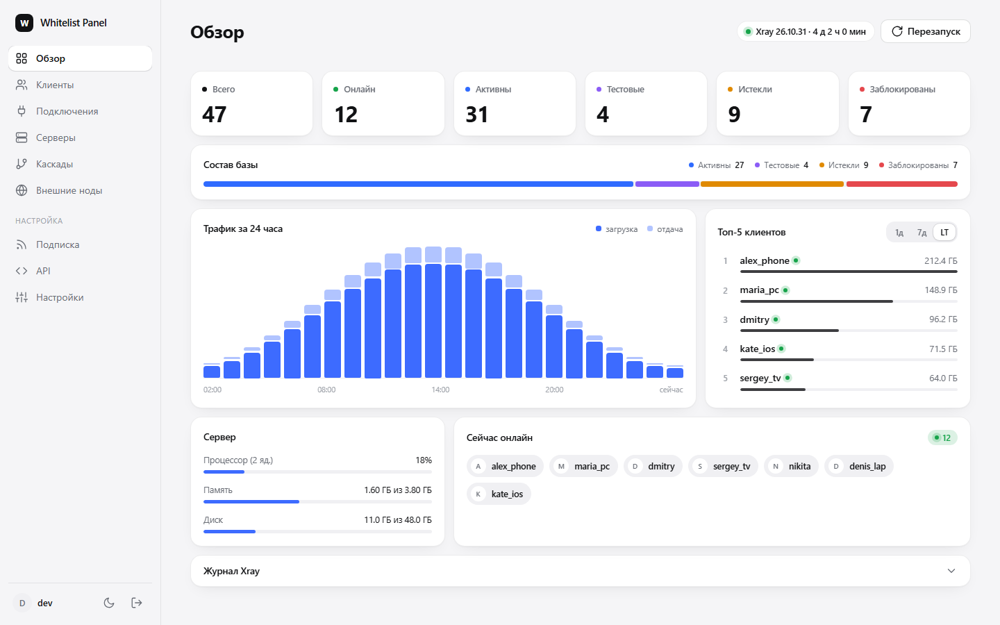
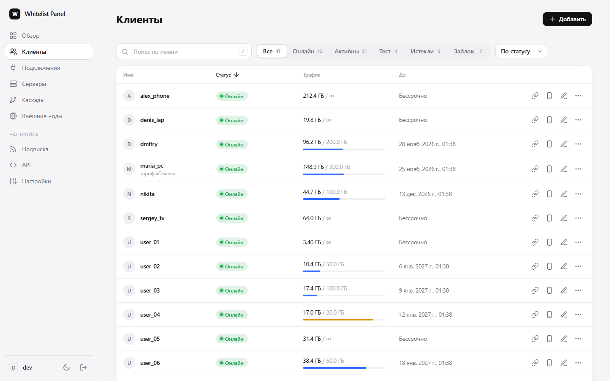
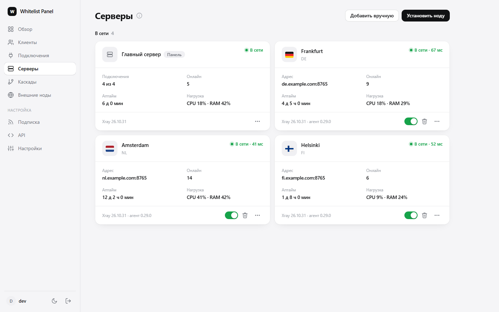
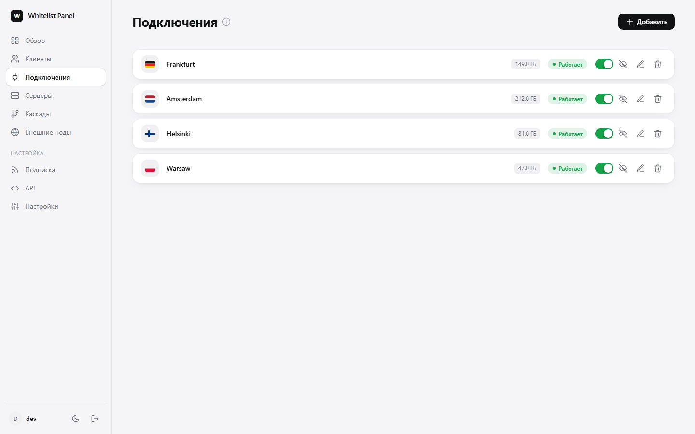
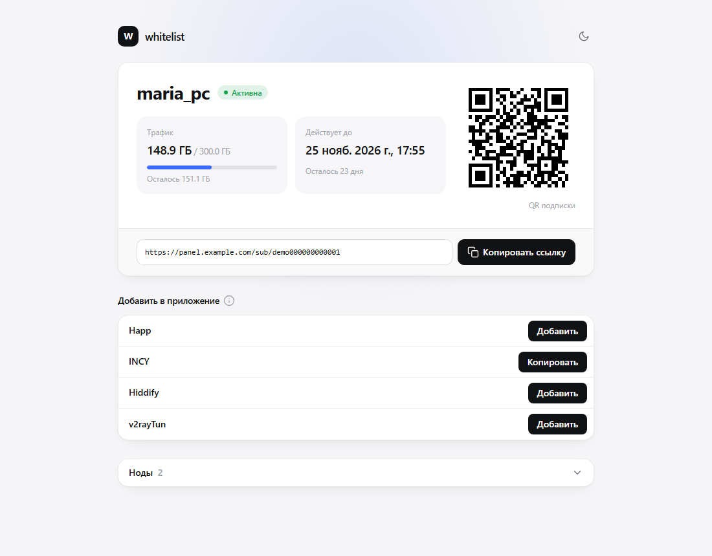
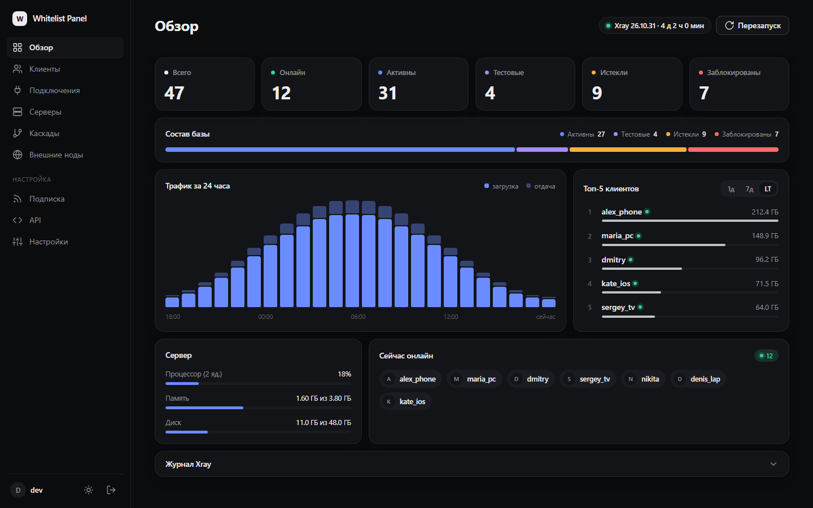
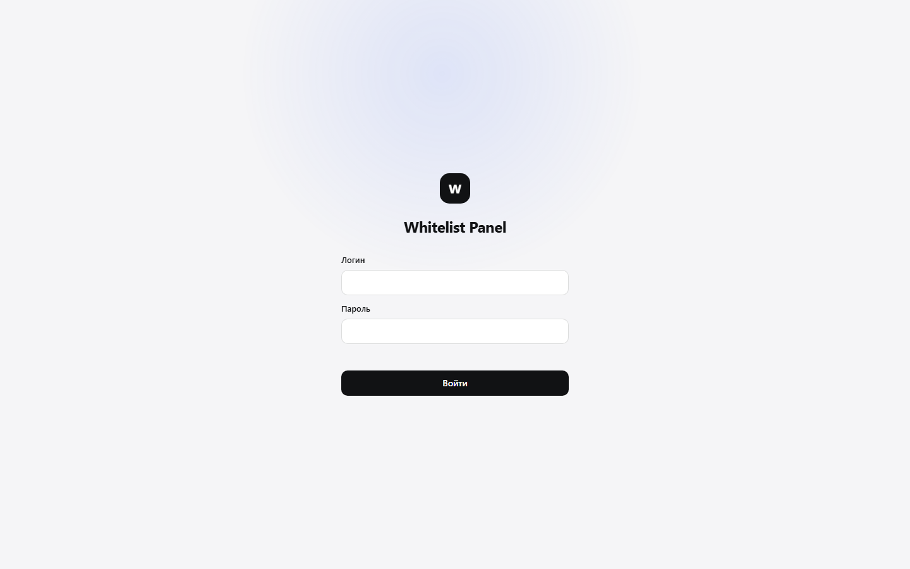

# Whitelist Panel

### Панель управления Xray: VLESS и Trojan, подписки, ноды, автоузел


Один бинарник с веб-интерфейсом: клиенты и подписки, подключения VLESS/Trojan со всеми настройками Xray, дополнительные
серверы, каскады и «автоузел», который сам выбирает самый быстрый сервер.

[Установка](#-быстрая-установка) • [Возможности](#-возможности) • [Как выглядит](#-как-выглядит) • [Требования](#-требования) • [Разделы панели](#-разделы-панели) • [API](#-api) • [Telegram-бот](#-telegram-бот)

<p align="center">
  
</p>

---

## 📑 Оглавление

- [Возможности](#-возможности)
- [Как выглядит](#-как-выглядит)
- [Требования](#-требования)
- [Быстрая установка](#-быстрая-установка)
- [Варианты установки](#-варианты-установки)
- [Обновление](#-обновление)
- [Нода на самом сервере панели](#-нода-на-самом-сервере-панели)
- [Дополнительные серверы (ноды)](#-дополнительные-серверы-ноды)
- [Разделы панели](#-разделы-панели)
- [Подписки и приложения](#-подписки-и-приложения)
- [Автоузел](#-автоузел)
- [API](#-api)
- [Telegram-бот](#-telegram-бот)
- [Команды](#-команды)
- [Архитектура](#-архитектура)
- [Сборка из исходников](#-сборка-из-исходников)
- [Безопасность](#-безопасность)
- [История версий](#-история-версий)
- [Лицензия](#-лицензия)

---

## ✨ Возможности

<table>
<tr>
<td width="50%" valign="top">

### Основное

| | |
|---|---|
| 👥 **Клиенты** | Лимит трафика, срок, тестовые подписки, блокировка |
| 🔌 **Подключения** | VLESS и Trojan, REALITY и TLS, все транспорты Xray |
| 🔗 **Подписки** | Список ссылок, Clash / Mihomo, Xray JSON |
| 📱 **Страница подписки** | QR, трафик, срок, кнопки для Happ и других приложений |
| 🌐 **Автоузел** | Клиент сам выбирает самый быстрый сервер и переключается при сбое |
| 📊 **Обзор** | Плитки статусов, график за 24 часа, топ-5 за 1д / 7д / всё время |

</td>
<td width="50%" valign="top">

### Инфраструктура

| | |
|---|---|
| 🖥 **Серверы** | Установка ноды по SSH, пинг, аптайм, нагрузка, онлайн |
| 🔀 **Каскады** | Вход на сервере A, выход через сервер B |
| 🧩 **Внешние ноды** | Чужие серверы по ссылке в подписку каждого клиента |
| 🤖 **Telegram-бот** | Статистика, управление клиентами, копия базы |
| 🔑 **API** | Доступ по токену из своих систем |
| 📦 **Перенос и DNS** | Импорт из прежней панели, A-записи в REG.RU |

</td>
</tr>
</table>

Дополнительно: устройства (HWID) с блокировкой, лимиты и автосброс трафика на подключение, все настройки Xray в форме и в JSON,
светлая и тёмная темы, поиск и сортировка клиентов, собственная карточка ссылки в мессенджерах.

---

## 📸 Как выглядит

<table>
  <tr>
    <td width="50%"><br><sub><b>Клиенты</b>: поиск, фильтр по статусу, сортировка по трафику</sub></td>
    <td width="50%"><br><sub><b>Серверы</b>: статус, пинг, аптайм, нагрузка, клиенты онлайн</sub></td>
  </tr>
  <tr>
    <td width="50%"><br><sub><b>Подключения</b>: флаг страны, трафик, включение одним переключателем</sub></td>
    <td width="50%"><br><sub><b>Страница подписки</b>: трафик, срок, QR, приложения, список нод</sub></td>
  </tr>
  <tr>
    <td width="50%"><br><sub><b>Тёмная тема</b></sub></td>
    <td width="50%"><br><sub><b>Вход</b></sub></td>
  </tr>
</table>

> На снимках показаны демонстрационные данные: имена, трафик и серверы выдуманы.

---

## 📋 Требования

| Требование | Подробности |
|---|---|
| **ОС** | Ubuntu 22.04 / 24.04 или Debian 12, x86_64, systemd |
| **Процессор и память** | от 1 vCPU и 1 ГБ RAM, лучше 2 ГБ (MongoDB и Xray на одной машине) |
| **Диск** | от 10 ГБ свободного места |
| **Доступ** | root (или `sudo`) по SSH |
| **Сеть** | публичный IPv4, свободные TCP-порты **80** и **443** |
| **Домены** | два: для панели и для REALITY, A-записи на IP сервера |
| **Ставится само** | MongoDB 8.0, nginx (stream), Caddy 2.7+, Xray 26.10.31 |
| **Для сборки** | Go 1.27+ и Node 24+ (только если собираете из исходников) |

Цифры по процессору, памяти и диску даны как ориентир, жёстких проверок установщик не делает.

---

## 🚀 Быстрая установка

Одна команда от root на чистом сервере. Домены нужно заранее направить A-записями на IP сервера:

```bash
bash <(curl -fsSL https://raw.githubusercontent.com/1takawa/whitelist-panel/main/install.sh)
```

Установщик спросит **два домена**:
1. **домен REALITY**: на нём сразу поднимется нода VLESS + REALITY на этом же сервере. Этот пункт можно **пропустить** (Enter): ноду поставите позже одной кнопкой в панели;
2. **домен панели**: адрес панели и подписок.

Те же домены можно передать ключами и ничего не вводить:

```bash
bash <(curl -fsSL https://raw.githubusercontent.com/1takawa/whitelist-panel/main/install.sh) \
  --reality-domain reality.example.com --panel-domain panel.example.com
```

Скрипт скачивает последний релиз, проверяет контрольную сумму и запускает основной установщик: он проверит систему и DNS,
поставит MongoDB, nginx, Caddy и Xray, создаст администратора, поднимет ноду на домене REALITY (если он указан) и выведет адрес, логин и пароль.
Данные входа сохраняются в `/root/anypanel-credentials.txt`: сохраните их и удалите файл.

После установки: **Подключения → Добавить → «VLESS + REALITY»**.

> Эта ссылка работает, пока репозиторий **открыт**. Если репозиторий закрыт, используйте установку по токену ниже.

<details>
<summary><b>Установка из закрытого репозитория (по токену GitHub)</b></summary>

**1.** Создайте токен: GitHub → Settings → Developer settings → Personal access tokens → *Fine-grained tokens*. Доступ только к этому репозиторию, право **Contents: Read-only**.

**2.** На сервере от root скачайте релиз и запустите установщик:

```bash
export GH_TOKEN=github_pat_...                                  # ваш токен
curl -fsSL -H "Authorization: Bearer $GH_TOKEN" -H "Accept: application/vnd.github.raw" \
  https://api.github.com/repos/1takawa/whitelist-panel/contents/scripts/fetch-release.sh -o fetch-release.sh
bash fetch-release.sh                                           # скачает и распакует последний релиз в ./whitelist-panel
cd whitelist-panel
sudo bash install.sh --panel-domain panel.example.com --reality-domain reality.example.com
```

</details>

---

## 📦 Варианты установки

### 1. Обычная (рекомендуется)

Команда из «Быстрой установки». Перед установкой установщик показывает план и просит подтвердить; без вопросов работает ключ `-y`.

### 2. Полностью автоматическая

```bash
export ANYPANEL_ADMIN_PASS='длинный-пароль-от-10-символов'
bash <(curl -fsSL https://raw.githubusercontent.com/1takawa/whitelist-panel/main/install.sh) --reality-domain reality.example.com --panel-domain panel.example.com \
  --email admin@example.com --admin-user admin -y
```

| Параметр | Значение по умолчанию |
|---|---|
| `--panel-domain` | обязателен (в терминале без ключа спросит): домен панели и подписок |
| `--reality-domain` | домен ноды VLESS + REALITY на этом сервере; без него в терминале спросит, а без терминала нода не ставится |
| `--skip-reality` | не ставить ноду сейчас и не спрашивать (позже: «Серверы» → «Поставить ноду») |
| `--email` | нет: адрес для Let's Encrypt |
| `--admin-user` | `admin` |
| `--admin-pass` | если не задан, генерируется; лучше передавать через `ANYPANEL_ADMIN_PASS` |
| `--skip-dns-check` | выключено: DNS проверяется (отключите, если домены за Cloudflare) |
| `--check` | только проверить требования и выйти |
| `-y`, `--yes` | не задавать вопросов |

### 3. Вручную по шагам

Что именно делает установщик, и как повторить это без него, описано в [docs/INSTALL.md](docs/INSTALL.md).

### Схема портов

```
Интернет :443 ──► nginx (stream, SNI)
                   ├─ домены нод REALITY ──► Xray   127.0.0.1:8444 и выше (по порту на домен)
                   └─ остальное          ──► Caddy  127.0.0.1:7443 ──► панель 127.0.0.1:28270
Интернет :80  ──► Caddy (выпуск сертификатов, перенаправление на HTTPS)
```

---

## 🔄 Обновление

От root на сервере с установленной панелью:

```bash
bash <(curl -fsSL https://raw.githubusercontent.com/1takawa/whitelist-panel/main/install.sh) upgrade
```

Тот же скрипт скачает новый релиз и обновит панель. Если репозиторий закрыт, скачайте релиз по токену (см. «Быструю установку») и запустите
`sudo bash install.sh upgrade` в его каталоге.

Заменяется только программа панели. Настройки, база, домены и сертификаты не трогаются. Если после перезапуска панель не отвечает,
установщик сам возвращает прежнюю версию (она лежит рядом как `/usr/local/bin/anypanel.prev`).

---

## 🖥 Нода на самом сервере панели

На сервере с панелью можно держать и свою ноду VLESS + REALITY на отдельном домене. Её можно поставить при установке (домен REALITY)
или позже: **Серверы → «Главный сервер» → «Поставить ноду»**, указать домен (A-запись на этот сервер). Панель проверит домен,
выпустит сертификат, поставит сайт-заглушку, добавит домен в nginx и создаст подключение, которое сразу попадёт в подписки всех клиентов.
Таких нод может быть несколько, у каждой свой домен. Нода обычное подключение: её можно выбрать входом или выходом **каскада**,
так что при переезде на другой сервер каскад остаётся.

## 🖥 Дополнительные серверы (ноды)

На ноде работают только Xray и лёгкий агент, панели и базы там нет. Управление, клиенты и статистика остаются на главном сервере.

В панели: **Серверы → Установить ноду**, дальше мастер:

1. адрес сервера и вход по SSH (пароль или ключ; пароль не сохраняется, панель делает свой ключ);
2. проверка сервера (ОС, порты, DNS домена);
3. установка Xray и агента, при желании сразу подключение VLESS + REALITY за nginx с сайтом-заглушкой.

Страна определяется по IP сервера сама (если её не указать). Редкие действия (перезапуск Xray, обновление агента, открытие портов,
REALITY-сайт, новый токен) лежат в меню «⋯» на карточке сервера.

---

## 🧭 Разделы панели

| Раздел | Что внутри |
|---|---|
| **Обзор** | плитки «Всего / Онлайн / Активны / Тестовые / Истекли / Заблокированы», состав базы, трафик за 24 часа, топ-5 клиентов, сервер, журнал Xray |
| **Клиенты** | таблица с поиском по имени, фильтром по статусу и сортировкой; ссылки, устройства, изменение, сброс трафика, удаление |
| **Подключения** | список с флагом страны, трафиком и переключателем; форма с вкладками «Основное / Протокол / Транспорт / Безопасность / Sniffing / Дополнительно» |
| **Серверы** | карточки нод: статус, пинг, аптайм, нагрузка, клиенты онлайн; установка и настройка |
| **Каскады** | цепочки «вход A → выход B» с отдельным названием и флагом |
| **Внешние ноды** | чужие серверы по ссылке, массовый импорт |
| **Подписка** | адрес и форматы, Happ, Incy, карточка ссылки в мессенджерах, автоузел |
| **API** | токен и документация со всеми методами |
| **Настройки** | домены, администратор, бот, REG.RU, выгрузка и загрузка базы |

---

## 🔗 Подписки и приложения

Одна ссылка выдаёт клиенту все серверы. Формат выбирается автоматически по приложению или отдельными адресами:

| Формат | Для чего |
|---|---|
| Список ссылок (base64) | большинство приложений |
| Clash / Mihomo | клиенты с YAML-профилями, группа с проверкой задержки |
| Xray JSON | Happ, INCY и другие клиенты на Xray, умеют автоузел |

Страница подписки (`https://домен/sub/<id>`) показывает имя, статус, трафик, срок, QR, приложения и свёрнутый список нод.
Для Happ и INCY настраиваются баннеры, маршрутизация, передача HWID и заголовки; результат виден на живом макете телефона рядом с настройками.

Карточка ссылки в Telegram и других мессенджерах настраивается во вкладке «Ссылка»: название, заголовок, описание и картинка.

---

## 🌐 Автоузел

Включается в **Настройки → Подписка → Автоузел**. В подписке появляется одна запись «🌐 Авто»: приложение само берёт сервер с наименьшей задержкой
и при сбое переключается на другой. Использует проверку задержки в Xray и группу `url-test` в Clash.

- Время реакции на сбой настраивается (интервал проверки и таймаут); при интервале 2–5 с переключение занимает несколько секунд.
- Подключения можно исключить из группы флажком «Не включать в автоузел».
- Нужно минимум два сервера; Happ и INCY получают формат JSON автоматически.

---

## 🔌 API

Все методы панели доступны по токену администратора. Токен создаётся в разделе **API** и показывается один раз.

| Метод | Путь | Что делает |
|---|---|---|
| `GET` | `/api/health` | состояние панели (без токена) |
| `GET` | `/api/dashboard` | данные «Обзора» |
| `GET` `POST` | `/api/clients` | список клиентов, создание |
| `GET` `PUT` `DELETE` | `/api/clients/{id}` | клиент |
| `POST` | `/api/clients/{id}/reset-traffic` | сбросить трафик |
| `GET` | `/api/clients/{id}/links` | ссылка подписки и ссылки подключений |
| `GET` `POST` | `/api/inbounds` | подключения |
| `GET` | `/api/servers` | серверы |
| `GET` | `/api/sub/{subId}` | данные страницы подписки (без токена) |
| `GET` | `/api/db/export` | выгрузка базы |

Пример (создать клиента):

```bash
curl -X POST https://panel.example.com/api/clients \
  -H "Authorization: Bearer ТОКЕН" -H "Content-Type: application/json" \
  -d '{"email":"client_123","inboundIds":["<id подключения>"],"enable":true,"totalBytes":53687091200}'
```

Полный список с примерами запросов и ответов: **API** в самой панели.

---

## 🤖 Telegram-бот

Включается в **Настройках**: токен бота и список администраторов. Бот сообщает об истёкших подписках, исчерпанном трафике,
сбоях Xray и серверов и присылает ежедневную копию базы.

| Команда | Что делает |
|---|---|
| `/stats` | сводка по клиентам и трафику |
| `/online` | кто сейчас онлайн |
| `/users` | список клиентов |
| `/client имя` | карточка клиента |
| `/add` | добавить клиента |
| `/on имя`, `/off имя` | включить или выключить клиента |
| `/reset имя` | сбросить трафик |
| `/extend` | продлить срок |
| `/del` | удалить клиента |
| `/restart` | перезапустить Xray |
| `/backup [full\|users]` | выгрузка базы |

---

## 🛠 Команды

| Команда | Что делает |
|---|---|
| `anypanel serve` | запускает панель |
| `anypanel init-admin ЛОГИН` | создаёт или сбрасывает администратора (пароль со stdin, от 10 символов) |
| `anypanel set-domains ПАНЕЛЬ REALITY` | сохраняет домены для ссылок |
| `anypanel import-legacy ФАЙЛ [--dry-run]` | импорт пользователей из прежней панели |
| `anypanel agent` | агент дополнительного сервера |
| `anypanel version` | версия |

Служба: `systemctl status anypanel`, журнал: `journalctl -u anypanel -f`.

---

## 🏗 Архитектура

```
┌─────────────────────────────────────────────┐
│  Веб-интерфейс (React, встроен в бинарник)  │
├─────────────────────────────────────────────┤
│  Go: API, подписки, учёт трафика, бот       │
├──────────────┬──────────────────────────────┤
│  MongoDB     │  Xray (конфиг, статистика)   │
└──────────────┴──────────────────────────────┘
        │ HTTPS + токен
        ▼
   Агент на ноде ──► Xray ноды
```

### Стек

| Слой | Технологии |
|---|---|
| Сервер | Go 1.27, один бинарник без зависимостей, go:embed |
| Интерфейс | React 19, Vite, Tailwind CSS 4, TypeScript |
| База | MongoDB 8.0 |
| Прокси | Xray-core 26.10 |
| Вход и HTTPS | nginx (stream, SNI) и Caddy 2.7+ |

### Структура

```
cmd/anypanel/        # точка входа: serve, agent, init-admin, ...
internal/panel/      # логика панели: клиенты, подключения, серверы, обзор
internal/server/     # HTTP API и раздача интерфейса
internal/xray/       # конфиг и управление Xray, статистика
internal/formats/    # подписки: Clash, Xray JSON, автоузел
internal/store/      # хранилище (MongoDB и память для разработки)
internal/agent/      # агент ноды
internal/nodeinstall/# установка ноды по SSH
frontend/            # интерфейс
deploy/install.sh    # установщик панели
scripts/             # вспомогательные скрипты
docs/                # установка вручную, заметки разработчика, скриншоты
```

---

## 🔨 Сборка из исходников

Нужны Go 1.27+ и Node 24+.

```bash
cd frontend && npm ci && npm run build && cd ..
go vet ./... && go test ./...
CGO_ENABLED=0 GOOS=linux GOARCH=amd64 go build -trimpath -ldflags "-s -w -X main.version=0.29.0" -o dist/anypanel ./cmd/anypanel
cp deploy/install.sh internal/nodeinstall/install-node.sh dist/
```

В каталоге `dist/` получится всё, что нужно установщику (`anypanel`, `install.sh`, `install-node.sh`). Подробнее для разработчиков: [docs/DEVELOPMENT.md](docs/DEVELOPMENT.md).

Релизы собирает GitHub Actions: тег вида `v0.29.0` запускает [workflow](.github/workflows/release.yml) и публикует архив `whitelist-panel-linux-amd64.tar.gz`.

---

## 🛡 Безопасность

- пароль администратора: argon2id, сессии в `HttpOnly` + `SameSite=Strict` cookie, в базе только хэш токена, срок 12 часов;
- 5 попыток входа в минуту на IP, защита от CSRF, CSP и `X-Frame-Options: DENY`;
- публичный ключ REALITY всегда выводится из приватного на сервере;
- внутренний порт Caddy (7443) установщик закрывает в `ufw`;
- агент ноды работает по HTTPS с токеном и закреплённым отпечатком сертификата.

---

## 📝 История версий

Список изменений: [CHANGELOG.md](CHANGELOG.md).

---

## 📄 Лицензия

Закрытый проект. Все права защищены.
